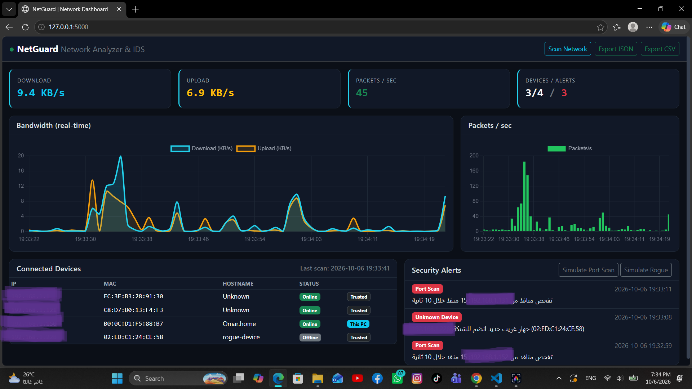

# NetGuard - Network Traffic Analyzer & Intrusion Detector

Real-time network monitoring dashboard built with Python (Flask).

## Features
- Device discovery on the local network (IP, MAC, Hostname)
- Live bandwidth and packets/sec charts
- Port scan detection and unknown device alerts
- Export reports as JSON or CSV

## Tech Stack
Flask, psutil, Scapy, Bootstrap, Chart.js

## Installation
    python -m venv venv
    venv\Scripts\activate
    pip install -r requirements.txt
    python app.py

Then open http://127.0.0.1:5000

## Live Packet Sniffing (optional)
Requires Npcap on Windows and Administrator privileges.
Set the environment variable `NTA_LIVE=1` before running.

## Disclaimer
Use this tool only on networks you own or have permission to monitor.